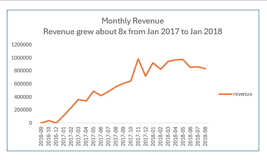
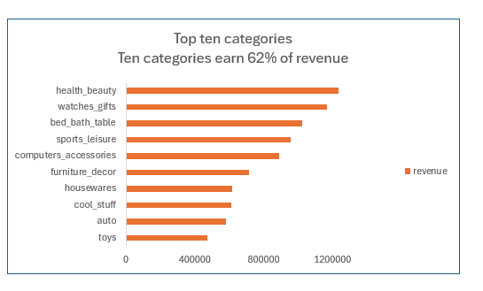
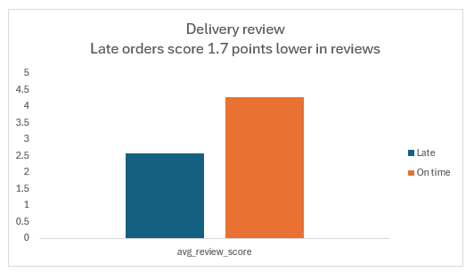

# Olist E-commerce Analysis in SQL

A SQL analysis of 99,441 orders from a Brazilian online marketplace (Olist), answering nine business questions on revenue, products, sellers, delivery, payments and customer loyalty.

## Problem

A marketplace owner wants to know where the money comes from and what affects customer satisfaction. I set nine questions:

1. How big is the business (orders, customers, revenue)?
2. How does revenue change month by month?
3. Which product categories earn the most?
4. How concentrated is revenue among sellers?
5. How long does delivery take, and how often is it late?
6. Which states generate the most revenue?
7. How do customers pay?
8. Do late deliveries lead to worse reviews?
9. How many customers buy more than once?

## Data

- **Source:** Brazilian E-Commerce Public Dataset by Olist, from Kaggle.
- **Period:** September 2016 to October 2018.
- **Size:** 9 linked tables. I used 8: orders, order items, payments, reviews, customers, products, sellers and a category-name translation table. I left out the geolocation table (over a million rows of map coordinates), which none of the questions needed.
- **Currency:** Brazilian reais (R$).
- The raw data is not included in this repository. It can be downloaded from Kaggle.

## Tools

SQLite through DB Browser for SQLite, and Excel for charts. All queries are in [`queries.sql`](queries.sql).

## Process

1. Imported the 8 CSV files into a SQLite database and checked every row count.
2. Explored the data for problems before analysing it (see the notes below).
3. Defined each metric in writing before querying it. **Revenue** means item price for delivered orders, excluding freight.
4. Wrote nine queries, building from simple counts to joins, subqueries, `CASE` logic and window functions.
5. Exported three result tables to Excel and charted them.

### Data checks and decisions

| Check | Result | Decision |
|---|---|---|
| Order status | 96,478 of 99,441 orders delivered (97%) | Revenue and delivery questions use delivered orders only |
| Missing delivery dates | 2,965 orders; all but 8 are non-delivered | The 8 delivered orders with no date are left out of delivery-time figures |
| Several reviews per order | 551 extra review rows | Reduced to one average score per order before joining |
| Customer identifiers | 99,441 `customer_id` values but 96,096 real customers | Counted people using `customer_unique_id` |
| Products without a category | 610 | Kept and labelled "unknown" |
| Date range | Very few orders in late 2016 and none after August 2018 among delivered orders | Trend statements cover January 2017 to August 2018 only |

## Key findings

**1. Size.** 96,478 delivered orders from 93,358 customers generated **R$13.22m** in revenue (about R$137 per order). Freight added R$2.20m, which is 17% of revenue.

**2. Growth.** Monthly revenue rose from R$112k in January 2017 to R$925k in January 2018, about eight times higher. November 2017 jumped 52% above October (R$988k), a pattern consistent with Black Friday. From early 2018 revenue levelled off at roughly R$830k to R$980k a month.

**3. Categories.** The top 10 categories earn 62% of revenue. Health and beauty leads (9.3%), followed by watches and gifts and then bed, bath and table. The rankings differ by measure: bed, bath and table sells the most items but earns less than watches and gifts, which sell about half as many at roughly twice the price per item (about R$199 against R$93).

**4. Sellers.** Revenue is spread widely. The largest seller holds 1.7% of revenue, and the top 10 together hold 13% out of about 3,000 sellers. Nine of the top 10 are based in São Paulo state.

**5. Delivery.** Orders arrive in 12.6 days on average, against 23.7 days promised. 8.1% of delivered orders (about 7,800) arrived after the estimated date.

**6. Geography.** São Paulo state accounts for 38% of revenue, and São Paulo, Rio de Janeiro and Minas Gerais together for 63%. The top 10 states hold 88%.

**7. Payments.** Credit cards make up 78.5% of payment value and boleto (a Brazilian bank-slip payment) 18.0%. Payment totals are higher than revenue because they include freight.

**8. Delivery and reviews.** Late orders average **2.57** out of 5 in reviews, against **4.29** for on-time orders, a gap of 1.7 points.

**9. Loyalty.** Only 3.0% of customers (2,801 of 93,358) placed more than one order.

## Recommendations

These are suggestions drawn from the patterns above, not proven causes.

- **Prioritise delivery reliability.** Late orders carry a 1.7-point review penalty, so reducing the 8% of late deliveries should improve satisfaction more than shortening the average delivery time.
- **Work on repeat purchases.** With only 3% of customers returning, growth depends on finding new customers. Retention efforts such as follow-up offers could be tested.
- **Look at freight costs.** Freight is 17% of revenue, which may discourage orders, especially for cheaper products.
- **Look beyond São Paulo.** Over a third of revenue comes from one state, so other regions are a possible growth area.

## Limitations

- The dataset has no cost data, so profit and margins cannot be measured.
- Late delivery is linked to low reviews, but the data cannot show that lateness caused them. Late orders may also differ in other ways, such as damaged goods or particular sellers.
- "Late" is measured against the estimated date shown to customers, so a generous estimate makes the late rate look better.
- Values are nominal reais and are not adjusted for inflation.
- The repeat-purchase figure only covers the period in the data, so customers who returned later are not counted.
- The first and last months of the data are partial, so growth is measured only for January 2017 to August 2018.

## SQL skills shown

Joins (inner and left), aggregation and `GROUP BY`, date functions, `CASE` logic, subqueries, window functions, `COALESCE` and duplicate handling.

## Files

- `queries.sql`: all nine queries
- `cleaning_notes.txt`: data checks and decisions
- `chart_revenue.png`, `chart_categories.png`, `chart_reviews.png`: charts

## About

Built by Cecilia Daramola as part of a data analytics portfolio. Economics graduate (University of Ibadan), with a background in accounting and procurement.
